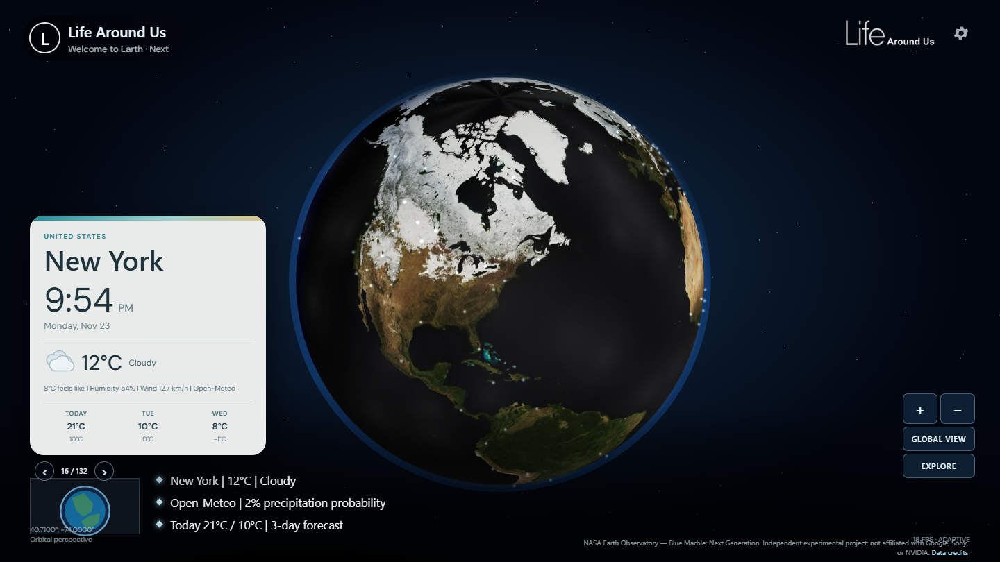
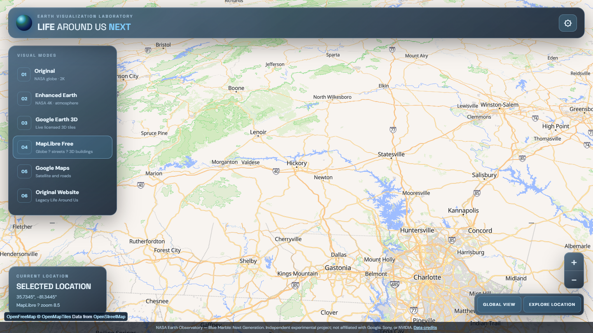

# Life Around Us: Next

**[Earth sources](#visual-modes) | [Roadmap](ROADMAP.md) | [Google tile usage](#google-maps-platform)**

An independent next-generation browser-based Earth renderer. This project is separate from the existing [Life Around Us](https://life.orosapp.us/) website, which is not modified.

## One Earth experience

The interface now follows the original **Life Around Us** presentation: a quiet header and original Life logo, the original-style city postcard, time and Open-Meteo weather, a three-day forecast, world city navigation, and a muted lower Earth information strip. **There is no separate globes list.** Switch imagery in the gear-shaped **Options / Settings / Earth imagery & map provider** selector. The Google choice expands into **Google Earth 3D** and **Google Satellite/Maps**; those remain optional and require the user's own enabled Maps API key.

Choosing a NASA texture renders the globe at 2K or 4K. Zooming close to the surface transitions into free MapLibre streets and buildings **at the same geographic coordinates**. Zooming back out returns to the selected NASA globe; choosing MapLibre directly keeps its own globe-to-streets renderer active. All stages occupy the same Earth viewport, rather than opening extra map windows. Google is integrated into the same single-view Settings structure but its licensed live imagery still requires actual credentials and hardware testing.

**Open-Meteo is retained:** the city card shows current temperature, matching WMO weather icons, humidity, wind, feels-like temperature, local date/time and a three-day forecast. The curated 132-city tour is imported from the previous Life app. Data is kept in a three-hour browser cache with a day of stale fallback and rate-limit backoff.

**Opt-in address beacon:** Settings accepts a user-supplied street address or city. Pressing **Find & Save Address** makes one public OpenStreetMap Nominatim search (the address is shared with that service), centers Earth, and stores the matched address/coordinates only in this browser's local storage. The home location appears as a **bright, pulsing blue beacon** on NASA Earth and MapLibre. The beacon can be disabled or the saved address removed in Settings. This feature never reads a visitor's device location or commits addresses to GitHub. The public Nominatim server permits only limited, identified requests and no autocomplete; a higher-traffic production deployment should use an independently provisioned geocoding service. See [Nominatim usage policy](https://operations.osmfoundation.org/policies/nominatim/).

## Visual modes

| Mode | Rendering | Current state |
| --- | --- | --- |
| Original | NASA Blue Marble 2K globe, WebGL | Implemented; classic Earth imagery within the unified Life interface |
| Enhanced Earth | NASA Blue Marble 4K plus atmosphere, clouds and high-quality rendering | Implemented |
| MapLibre Free | WebGL globe-to-streets, OpenFreeMap Liberty/Dark/Positron styles, OpenStreetMap roads and 3D building layers | Implemented, tested in browser, no key or billing |
| Google Earth 3D | CesiumJS with Google Map Tiles API Photorealistic 3D Tiles | Key/billing required; real Google test pending |
| Google Maps | Maps JavaScript API hybrid satellite/road map | Key/billing required; real Google test pending |
| Original Website | Open the separate live original in a new browser tab | Implemented |

The NASA image is a standard global equirectangular projection. Click a point to obtain longitude and latitude, then switch modes using those same coordinates. Google Earth provides native geodetic coordinates and physically streamed 3D geometry; Google imagery is **never extracted, upscaled, or baked into another Earth texture**.

## Free MapLibre navigation

Choose **MapLibre** under Options / Settings / Earth imagery & map provider, or zoom toward a city from the NASA globe. This loads [MapLibre GL JS](https://maplibre.org/maplibre-gl-js/) only when opened, using free OpenStreetMap-derived vector tiles from [OpenFreeMap](https://openfreemap.org/). It uses the latitude and longitude selected on the NASA globe to center the map. Select any map location to save that position, then zoom, pinch, tilt, or drag to explore streets and 3D buildings where mapped data exists. **Global View** returns to a distant map projection; zooming out far enough from a NASA-initiated close-up returns to NASA imagery.

Settings also offers Liberty, Dark, and Positron styles without a Google Maps API key, billing account, or credit card. OpenStreetMap and provider attribution stays visible. The free mode does not supply Google's proprietary satellite photography or photorealistic 3D buildings. No guarantee of zero-latency navigation or offline access is made; the public tile service may impose fair-use restrictions. For high-traffic use, independently host or contract an appropriate tile provider. The website does not scrape or archive public tiles.

## Performance

The application uses a Three.js WebGL globe with physically based surface illumination, a shader-based atmosphere, a separate cloud layer, stars, and capped/adaptive display pixel ratio. The 4K texture is 4096x2048 pixels, not a claim of DLSS. Google SDKs are only loaded on demand.

The goal is to minimize waiting through smart LOD, smooth animations and preloaded **authorized** imagery, but it is technically impossible to guarantee instant zoom into live Google 3D geometry at arbitrary distances on every network. This project does not implement Nvidia DLSS in the browser. An RTX 3080 can preprocess permitted NASA imagery offline and render this experience locally; remote visitors use their own GPUs.

## Google Maps Platform

Google Earth 3D and Google Maps modes require a billing-enabled Google Cloud project, an API key restricted to the allowed website referrers, and the relevant Google Map Tiles API and Maps JavaScript API. Enable daily quotas and spend alerts before use. In Settings enter a key for the current browser tab only; the project never writes it to GitHub, localStorage or its own server. It is necessarily sent in browser requests to Google. No Google content is scraped, bulk downloaded, prefetched outside API permissions, or permanently cached. The Google Maps logo and data attribution must remain visible.

Official documentation:
- https://developers.google.com/maps/documentation/tile/3d-tiles
- https://developers.google.com/maps/documentation/tile/policies
- https://developers.google.com/maps/documentation/tile/usage-and-billing
- https://cesium.com/learn/cesiumjs-learn/cesiumjs-photorealistic-3d-tiles

## Earth imagery

NASA Blue Marble: Next Generation January 2004 global base map (original 2K) and its official topography/bathymetry variant (enhanced 4K), from 5400x2700 global equirectangular sources. The 4K variant has mild contrast, color and sharpness enhancement, with no fabricated new terrain detail. Image credit: NASA Earth Observatory.

Sources:
- https://science.nasa.gov/earth/earth-observatory/blue-marble-next-generation/base-map/
- https://science.nasa.gov/earth/earth-observatory/blue-marble-next-generation/base-topography-bathymetry/

## Development

Requires Node 22+.

    npm install
    npm test
    npm run dev
    npm run build

The site can be deployed from this repository through Cloudflare Workers Static Assets, as configured in wrangler.jsonc. GitHub is source control, Cloudflare hosts the web files. Existing live Life Around Us remains a separate site and separate codebase.

See ROADMAP.md for the verified and pending tasks.
