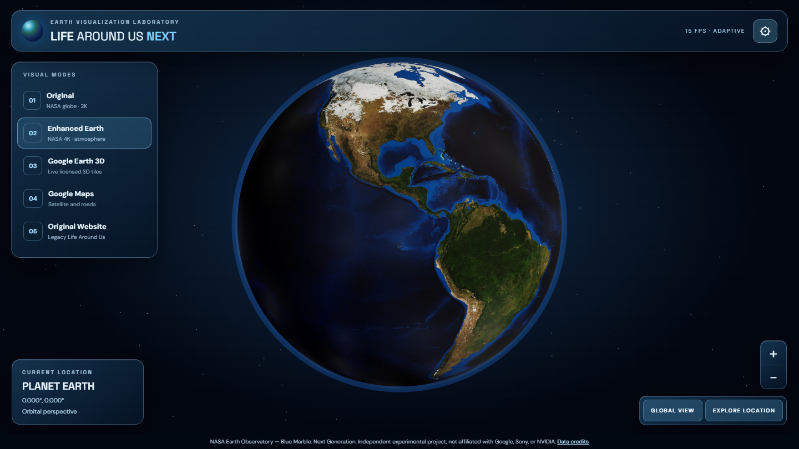

# Life Around Us: Next

**[Earth modes](#visual-modes) ? [Roadmap](ROADMAP.md) ? [Google tile usage](#google-maps-platform)**

An independent next-generation browser-based Earth renderer. This project is separate from the existing [Life Around Us](https://life.orosapp.us/) website, which is not modified.

## Visual modes

| Mode | Rendering | Current state |
| --- | --- | --- |
| Original | NASA Blue Marble 2K globe, WebGL | Implemented; not an exact copy of the original website UI |
| Enhanced Earth | NASA Blue Marble 4K plus atmosphere, clouds and high-quality rendering | Implemented |
| Google Earth 3D | CesiumJS with Google Map Tiles API Photorealistic 3D Tiles | Key/billing required; real Google test pending |
| Google Maps | Maps JavaScript API hybrid satellite/road map | Key/billing required; real Google test pending |
| Original Website | Open the separate live original in a new browser tab | Implemented |

The NASA image is a standard global equirectangular projection. Click a point to obtain longitude and latitude, then switch modes using those same coordinates. Google Earth provides native geodetic coordinates and physically streamed 3D geometry; Google imagery is **never extracted, upscaled, or baked into another Earth texture**.

## Performance

The application uses a Three.js WebGL globe with physically based surface illumination, a shader-based atmosphere, a separate cloud layer, stars, and capped/adaptive display pixel ratio. The 4K texture is 4096x2048 pixels, not a claim of DLSS. Google SDKs are only loaded on demand.

The goal is to minimize waiting through smart LOD, smooth animations and preloaded **authorized** imagery, but it is technically impossible to guarantee instant zoom into live Google 3D geometry at arbitrary distances on every network. This project does not implement Nvidia DLSS in the browser. An RTX 3080 can preprocess permitted NASA imagery offline and render this experience locally; remote visitors use their own GPUs.

## Google Maps Platform

Google Earth 3D and Google Maps modes require a billing-enabled Google Cloud project, an API key restricted to the allowed website referrers, and the relevant Google Map Tiles API and Maps JavaScript API. Enable daily quotas and spend alerts before use. In Settings enter a key for the current browser tab only; the project never writes it to GitHub, localStorage or its own server. It is necessarily sent in browser requests to Google. No Google content is scraped, bulk downloaded, prefetched outside API permissions, or permanently cached. The Google Maps logo and data attribution must remain visible.

Official documentation:
- https://developers.google.com/maps/documentation/tile/3d-tiles
- https://developers.google.com/maps/documentation/tile/policies
- https://developers.google.com/maps/documentation/tile/usage-and-billing
- https://cesium.com/learn/cesiumjs-learn/cesiumjs-photorealistic-3d-tiles

## Earth imagery

NASA Blue Marble: Next Generation January 2004 global base map (original 2K) and its official topography/bathymetry variant (enhanced 4K), from 5400x2700 global equirectangular sources. The 4K variant has mild contrast, color and sharpness enhancement, with no fabricated new terrain detail. Image credit: NASA Earth Observatory.

Sources:
- https://science.nasa.gov/earth/earth-observatory/blue-marble-next-generation/base-map/
- https://science.nasa.gov/earth/earth-observatory/blue-marble-next-generation/base-topography-bathymetry/

## Development

Requires Node 22+.

    npm install
    npm test
    npm run dev
    npm run build

The site can be deployed from this repository through Cloudflare Workers Static Assets, as configured in wrangler.jsonc. GitHub is source control, Cloudflare hosts the web files. Existing live Life Around Us remains a separate site and separate codebase.

See ROADMAP.md for the verified and pending tasks.
